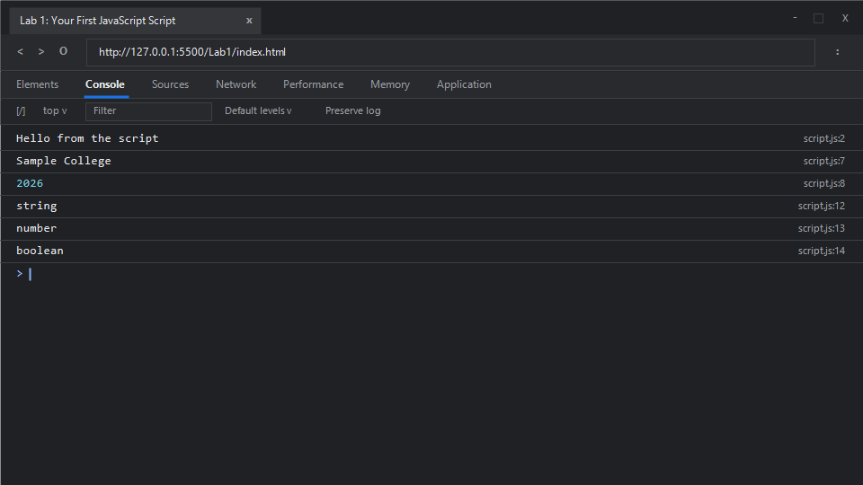

# EXPERIMENT NO. 1

## 1. Experiment Title
Your First JavaScript Script

## 2. Aim
Run a script in the browser and with Node, and declare values with `const` and `let`.

## 3. Software / Tools Required
- **Operating System**: Windows 10 / 11
- **Web Browser**: Google Chrome / Microsoft Edge (Developer Tools F12)
- **Runtime Environment**: Node.js (v18+)
- **Code Editor / IDE**: Visual Studio Code

## 4. Theory
JavaScript is a versatile, high-level, interpreted scripting language primarily used to build interactive and dynamic client-side web applications, as well as server-side runtimes via Node.js.

- **Console Output**: The `console.log()` method outputs messages, evaluated expressions, or objects to the web browser's debugging console or the terminal in Node.js.
- **Variable Declarations (`let` and `const`)**:
  - `const`: Used to declare block-scoped constants. A variable declared with `const` cannot be reassigned or re-declared within its scope. It must be initialized at the time of declaration.
  - `let`: Declares a reassignable, block-scoped local variable. Unlike `var`, `let` prevents issues related to variable hoisting and leaking variables outside curly braces `{}`.
- **Data Types and `typeof` Operator**:
  - JavaScript is dynamically typed. Common primitive types include `string`, `number`, `boolean`, `null`, `undefined`, `symbol`, and `bigint`.
  - The unary operator `typeof` returns a string representing the evaluation type of an operand (e.g., `'string'`, `'number'`, `'boolean'`).

## 5. Algorithm / Procedure
1. **Task 1**:
   - Write a statement using `console.log()` passing `"Hello from the script"`.
   - Embed the script within an HTML document and open it in a browser to inspect the output using F12 developer console.
2. **Task 2**:
   - Declare a constant identifier `schoolName` and initialize it with string `"Sample College"`.
   - Declare a mutable variable `year` using `let` and assign it numeric value `2026`.
   - Print `schoolName` and `year` on separate lines using `console.log()`.
3. **Task 3**:
   - Apply the `typeof` operator to `"hello"`, `7`, and `true`.
   - Print each evaluated data type on a new line using `console.log()`.
4. Execute the script in Node.js via terminal: `node script.js`.

## 6. Program / Queries / Commands

### File: `script.js`
```javascript
/**
 * Experiment 1: Your First JavaScript Script
 * Tasks:
 * 1. Print "Hello from the script" with console.log
 * 2. Declare constant schoolName and let year, print both values
 * 3. Print the typeof "hello", 7, and true
 */

// Task 1: Print greeting message to the console
console.log("Hello from the script");

// Task 2: Variable declarations using const and let
const schoolName = "Sample College";
let year = 2026;
console.log(schoolName);
console.log(year);

// Task 3: Data type inspection using the typeof operator
console.log(typeof "hello");
console.log(typeof 7);
console.log(typeof true);
```

### Execution Commands:
- **Node.js**:
  ```bash
  node script.js
  ```
- **Browser**:
  Open `index.html` in Chrome/Edge and open Developer Tools (<kbd>F12</kbd> &rarr; **Console**).

## 7. Input
- Static constant string: `"Sample College"`
- Static numeric variable: `2026`
- Literals for type inspection: `"hello"`, `7`, `true`

## 8. Output

### Expected Console Output:
```text
Hello from the script
Sample College
2026
string
number
boolean
```

### Browser Console Screenshot:


## 9. Result
The experiment was successfully performed. A JavaScript script was executed both inside a browser environment and through the Node.js runtime. Concepts of variable declarations using `const` and `let` and primitive type inspection via `typeof` were verified.

## 10. Viva-Voce Questions
1. **What is the fundamental difference between `var`, `let`, and `const`?**
   - `var` is function-scoped and hoisted with an initial value of `undefined`. Both `let` and `const` are block-scoped and live in a Temporal Dead Zone (TDZ) until their declaration is evaluated. `const` prevents variable reassignment, whereas `let` allows reassigning values.
2. **What does the `typeof` operator return for `null`, and why?**
   - `typeof null` returns `"object"`. This is a well-known legacy bug in JavaScript from its first implementation in 1995, where values had type tags, and `null` was represented with a NULL pointer type tag (`0x00`), which collided with object type tags.
3. **What is the global object in a web browser vs. in Node.js?**
   - In a web browser, the top-level global object is `window` (or `globalThis`). In Node.js, the top-level global object is `global` (or `globalThis`).
4. **Why is `console.log` widely used in JavaScript development?**
   - It sends output directly to the debugging console, allowing developers to inspect variables, track control flow, and identify runtime errors without interrupting page rendering.

