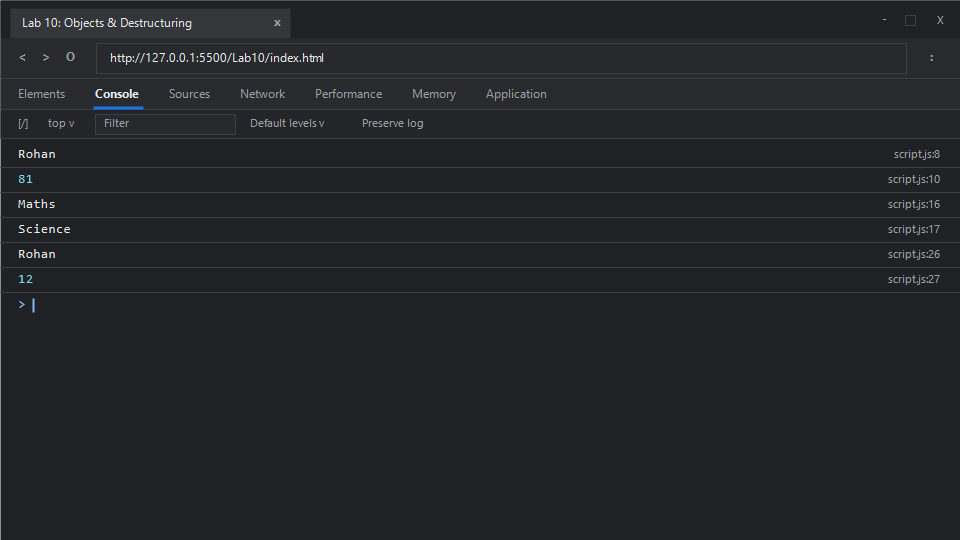

# EXPERIMENT NO. 10

## 1. Experiment Title
Objects and Destructuring

## 2. Aim
Create an object, read and change its properties, and take values out of an array and an object with destructuring.

## 3. Software / Tools Required
- **Operating System**: Windows 10 / 11
- **Web Browser**: Google Chrome / Microsoft Edge (Developer Tools F12)
- **Runtime Environment**: Node.js (v18+)
- **Code Editor / IDE**: Visual Studio Code

## 4. Theory
- **JavaScript Objects**:
  - Collections of key-value pairs (properties). Keys are strings or Symbols, and values can be any JavaScript data type. Properties can be accessed and modified using dot notation (`object.property`) or bracket notation (`object["property"]`).
- **Destructuring Assignment**:
  - A concise syntax introduced in ECMAScript 2015 (ES6) that allows unpacking values from arrays or properties from objects into distinct variables.
  - **Array Destructuring**: Uses square brackets `[a, b] = array` to unpack items positional-wise from index 0 upwards.
  - **Object Destructuring**: Uses curly braces `{ prop1, prop2 } = object` to extract properties matching property keys regardless of position.

## 5. Algorithm / Procedure
1. **Task 1 (Object Property Access and Mutation)**:
   - Create object `student1` with properties `name: "Rohan"`, `roll: 12`, and `marks: 78`.
   - Access and print `student1.name`.
   - Mutate `student1.marks = 81`.
   - Access and print `student1.marks`.
2. **Task 2 (Array Destructuring)**:
   - Create array `subjects = ["Maths", "Science", "English"]`.
   - Destructure the first two items into variables: `const [first, second] = subjects;`.
   - Print `first` and `second` on separate lines.
3. **Task 3 (Object Destructuring)**:
   - Create object `student2 = { name: "Rohan", roll: 12, marks: 81 }`.
   - Destructure properties: `const { name, roll } = student2;`.
   - Print `name` and `roll` on individual lines.
4. Run in Node.js and inspect the browser console.

## 6. Program / Queries / Commands

### File: `script.js`
```javascript
/**
 * Experiment 10: Objects and Destructuring
 * Tasks:
 * 1. Object student { name: "Rohan", roll: 12, marks: 78 }, print name, update marks to 81, print marks
 * 2. Array ["Maths", "Science", "English"], array destructuring into first and second, print each
 * 3. Object { name: "Rohan", roll: 12, marks: 81 }, object destructuring for name and roll, print each
 */

// Task 1: Object properties and property mutation
const student1 = {
    name: "Rohan",
    roll: 12,
    marks: 78
};

console.log(student1.name);  // "Rohan"
student1.marks = 81;
console.log(student1.marks); // 81

// Task 2: Array Destructuring
const subjects = ["Maths", "Science", "English"];
const [first, second] = subjects;

console.log(first);  // "Maths"
console.log(second); // "Science"

// Task 3: Object Destructuring
const student2 = {
    name: "Rohan",
    roll: 12,
    marks: 81
};

const { name, roll } = student2;
console.log(name); // "Rohan"
console.log(roll); // 12
```

### Execution Commands:
- **Node.js**:
  ```bash
  node script.js
  ```
- **Browser**:
  Open `index.html` in Chrome/Edge and open Developer Tools (<kbd>F12</kbd> &rarr; **Console**).

## 7. Input
- Task 1: `{ name: "Rohan", roll: 12, marks: 78 }` with update to `81`
- Task 2: `["Maths", "Science", "English"]`
- Task 3: `{ name: "Rohan", roll: 12, marks: 81 }`

## 8. Output

### Expected Console Output:
```text
Rohan
81
Maths
Science
Rohan
12
```

### Browser Console Screenshot:


## 9. Result
Object instantiation, dynamic property mutation, array element destructuring, and object property destructuring were successfully executed and validated.

## 10. Viva-Voce Questions
1. **Can you assign default values during object destructuring?**
   - Yes, by providing an assignment in the pattern, e.g., `const { name, grade = "A" } = student;`. If `grade` is `undefined`, it defaults to `"A"`.
2. **How do you rename variables during object destructuring?**
   - Using a colon syntax, e.g., `const { name: studentName } = student;` assigns the property `name` to a new variable called `studentName`.
3. **What is the rest operator (`...`) in array destructuring?**
   - The rest syntax `[first, ...rest] = array` gathers all remaining elements into a new array called `rest`.
4. **What happens if you destructure a property that does not exist on an object?**
   - The resulting variable receives the value `undefined`.

