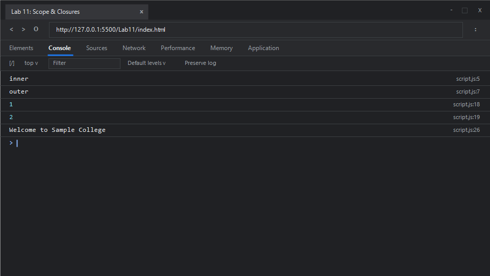

# EXPERIMENT NO. 11

## 1. Experiment Title
Scope and Closures

## 2. Aim
Explain block scope and global scope, and use a function that returns a function that keeps a value between calls.

## 3. Software / Tools Required
- **Operating System**: Windows 10 / 11
- **Web Browser**: Google Chrome / Microsoft Edge (Developer Tools F12)
- **Runtime Environment**: Node.js (v18+)
- **Code Editor / IDE**: Visual Studio Code

## 4. Theory
- **Lexical Scope**:
  - Scope in JavaScript is lexical (static), meaning the scope of an identifier is determined by its physical location within the source code. An inner function has access to variables declared in its outer enclosing scope.
- **Block Scope vs. Global Scope**:
  - **Global Scope**: Variables declared outside of any block or function are globally accessible.
  - **Block Scope**: Variables declared with `let` and `const` inside a block `{}` are only accessible within those braces. Shadowing occurs when an inner block declares a variable with the same name as an outer variable without mutating the outer identifier.
- **Closures**:
  - A closure is the combination of a function bundled together (enclosed) with references to its surrounding lexical state (the lexical environment). Even after the outer function has completed execution and returned, the returned inner function retains access to the outer function’s local variables in memory.

## 5. Algorithm / Procedure
1. **Task 1 (Block Scope & Shadowing)**:
   - Declare variable `level = "outer"` using `let`.
   - Open a block `{}` and declare `let level = "inner"`. Print `level` inside the block (outputs `"inner"`).
   - Exit the block and print `level` (outputs `"outer"`).
2. **Task 2 (Closure State Preservation)**:
   - Define higher-order function `makeCounter()`.
   - Initialize private variable `count = 0`.
   - Return an anonymous function that increments `count` by 1 and returns it.
   - Assign `const counter = makeCounter();`.
   - Invoke `counter()` twice and print each result (`1`, then `2`).
3. **Task 3 (Global Scope Access)**:
   - Declare `school = "Sample College"` in the global scope.
   - Define function `showSchool()` that reads `school` and prints `"Welcome to " + school`.
   - Invoke `showSchool()`.
4. Run in Node.js and inspect the browser console.

## 6. Program / Queries / Commands

### File: `script.js`
```javascript
/**
 * Experiment 11: Scope and Closures
 * Tasks:
 * 1. Variable level = "outer", inside block { let level = "inner"; print }, outside print level
 * 2. Function makeCounter: count = 0, returns function adding 1 to count and returning it. Call twice and print each
 * 3. Global school = "Sample College", function showSchool prints "Welcome to <school>", call showSchool
 */

// Task 1: Block Scope vs Outer Scope (Variable Shadowing)
let level = "outer";
{
    let level = "inner";
    console.log(level); // "inner"
}
console.log(level);     // "outer"

// Task 2: Closures with makeCounter
function makeCounter() {
    let count = 0;
    return function() {
        count += 1;
        return count;
    };
}

const counter = makeCounter();
console.log(counter()); // 1
console.log(counter()); // 2

// Task 3: Global Scope Lexical Lookup
let school = "Sample College";

function showSchool() {
    console.log("Welcome to " + school);
}

showSchool(); // "Welcome to Sample College"
```

### Execution Commands:
- **Node.js**:
  ```bash
  node script.js
  ```
- **Browser**:
  Open `index.html` in Chrome/Edge and open Developer Tools (<kbd>F12</kbd> &rarr; **Console**).

## 7. Input
- Task 1: Outer string `"outer"`, inner string `"inner"`
- Task 2: Initial counter state `0`, incrementing consecutively
- Task 3: Global string `"Sample College"`

## 8. Output

### Expected Console Output:
```text
inner
outer
1
2
Welcome to Sample College
```

### Browser Console Screenshot:


## 9. Result
Block-level scoping with `let`, variable shadowing, persistent state encapsulation via closures, and global lexical scope resolution were successfully implemented and verified.

## 10. Viva-Voce Questions
1. **What is the practical use of closures in JavaScript?**
   - Closures are used for data privacy and encapsulation (creating private variables), function factories, currying, memoization, and maintaining state across asynchronous callbacks.
2. **What is the Temporal Dead Zone (TDZ)?**
   - The period between the start of a block and the declaration of a `let` or `const` variable where accessing the variable throws a `ReferenceError`.
3. **Does `var` respect block scope?**
   - No, `var` is function-scoped (or globally scoped if declared outside a function). Variables declared with `var` inside `if` or `for` blocks leak outside the block.
4. **Can closures lead to memory leaks?**
   - Yes, if a closure holds references to large objects or DOM nodes that are no longer needed, the JavaScript garbage collector cannot release that memory until all references to the closure itself are removed.

