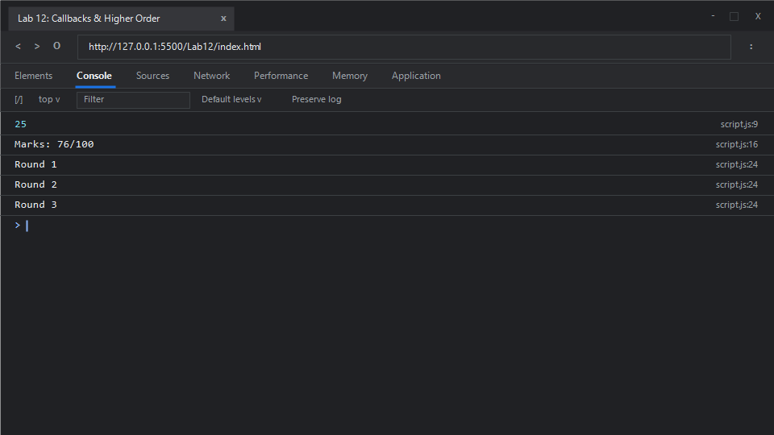

# EXPERIMENT NO. 12

## 1. Experiment Title
Callbacks and Higher-Order Functions

## 2. Aim
Pass a function as an argument to another function and call it.

## 3. Software / Tools Required
- **Operating System**: Windows 10 / 11
- **Web Browser**: Google Chrome / Microsoft Edge (Developer Tools F12)
- **Runtime Environment**: Node.js (v18+)
- **Code Editor / IDE**: Visual Studio Code

## 4. Theory
- **First-Class Functions**:
  - In JavaScript, functions are first-class citizens. They can be assigned to variables, stored in data structures, passed as arguments to other functions, and returned from functions just like strings or numbers.
- **Higher-Order Functions (HOFs)**:
  - Any function that accepts one or more functions as arguments and/or returns a function as its result.
- **Callback Functions**:
  - A function passed into another function as an argument, which is then invoked inside the outer function to complete some kind of routine or action. Callbacks can be synchronous (like in `.map()` or custom iterators) or asynchronous (like in timer events or network fetches).

## 5. Algorithm / Procedure
1. **Task 1 (Function Composition with `applyTwice`)**:
   - Define higher-order function `applyTwice(fn, val)` returning `fn(fn(val))`.
   - Define helper function `addTen(num)` returning `num + 10`.
   - Call `applyTwice(addTen, 5)` (evaluates to `(5 + 10) + 10 = 25`) and print.
2. **Task 2 (Formatting via Callback)**:
   - Define `formatMarks(marks, callback)` returning `callback(marks)`.
   - Invoke `formatMarks(76, (marks) => "Marks: " + marks + "/100")`.
   - Print the formatted output string (`"Marks: 76/100"`).
3. **Task 3 (Custom Iterator Loop `repeatAction`)**:
   - Define `repeatAction(times, action)`.
   - Execute a loop from `round = 1` up to `times`, calling `action(round)` on each step.
   - Invoke `repeatAction(3, (round) => console.log("Round " + round))`.
4. Run in Node.js and inspect the browser console.

## 6. Program / Queries / Commands

### File: `script.js`
```javascript
/**
 * Experiment 12: Callbacks and Higher-Order Functions
 * Tasks:
 * 1. Function applyTwice(fn, val): calls fn(val), then fn on result. addTen(x) adds 10. Print applyTwice(addTen, 5)
 * 2. Function formatMarks(marks, callback): returns callback(marks). Call with 76 and (m) => "Marks: " + m + "/100"
 * 3. Function repeatAction(times, action): calls action(round) from 1 to times. Call with 3 and (round) => print "Round <round>"
 */

// Task 1: Higher-Order Function applyTwice
function applyTwice(fn, val) {
    return fn(fn(val));
}

function addTen(num) {
    return num + 10;
}

console.log(applyTwice(addTen, 5)); // (5 + 10) + 10 = 25

// Task 2: Callback function for string formatting
function formatMarks(marks, callback) {
    return callback(marks);
}

const formattedResult = formatMarks(76, (marks) => `Marks: ${marks}/100`);
console.log(formattedResult); // "Marks: 76/100"

// Task 3: Higher-Order Iteration with repeatAction
function repeatAction(times, action) {
    for (let round = 1; round <= times; round++) {
        action(round);
    }
}

repeatAction(3, (round) => {
    console.log("Round " + round);
});
```

### Execution Commands:
- **Node.js**:
  ```bash
  node script.js
  ```
- **Browser**:
  Open `index.html` in Chrome/Edge and open Developer Tools (<kbd>F12</kbd> &rarr; **Console**).

## 7. Input
- Task 1: Function `addTen`, initial value `5`
- Task 2: Marks value `76`, formatter callback `(m) => "Marks: " + m + "/100"`
- Task 3: Count `3`, action callback logging round numbers

## 8. Output

### Expected Console Output:
```text
25
Marks: 76/100
Round 1
Round 2
Round 3
```

### Browser Console Screenshot:


## 9. Result
First-class function behaviors, callback argument passing, function composition through higher-order routines, and customized looping abstractions were successfully executed and validated.

## 10. Viva-Voce Questions
1. **What is "Callback Hell", and how does modern JavaScript avoid it?**
   - Callback hell refers to heavily nested, pyramid-shaped callbacks resulting from multiple asynchronous operations, making code difficult to read and maintain. Modern JavaScript avoids it using `Promises` and `async/await` syntax.
2. **What is the difference between a synchronous and asynchronous callback?**
   - A synchronous callback is executed immediately during the execution of the higher-order function (e.g., `Array.prototype.map`). An asynchronous callback is registered and executed later once an asynchronous task completes (e.g., `setTimeout` or `fetch`).
3. **What is function currying?**
   - A technique of transforming a function that takes multiple arguments into a sequence of functions, each taking a single argument.
4. **Why are higher-order functions fundamental in functional programming?**
   - They promote declarative programming, code reusability, immutability, and modularity by separating iteration mechanics from business logic.

