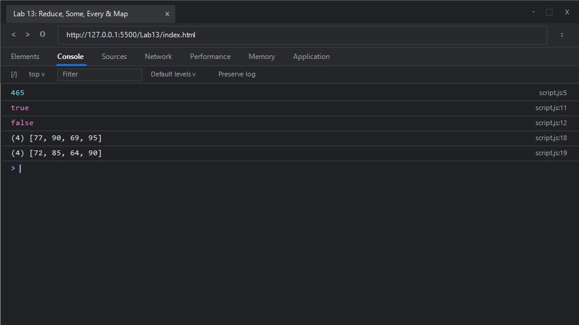

# EXPERIMENT NO. 13

## 1. Experiment Title
Reduce, Some, Every and Map

## 2. Aim
Use `reduce`, `some`, `every` and `map` on arrays, and keep the original array unchanged.

## 3. Software / Tools Required
- **Operating System**: Windows 10 / 11
- **Web Browser**: Google Chrome / Microsoft Edge (Developer Tools F12)
- **Runtime Environment**: Node.js (v18+)
- **Code Editor / IDE**: Visual Studio Code

## 4. Theory
- **Array.prototype.reduce()**:
  - Executes a user-supplied "reducer" callback function on each element of the array, in order, passing in the return value from the calculation on the preceding element. The final result of running the reducer across all elements is a single aggregated value.
- **Array.prototype.some()**:
  - Tests whether at least one element in the array passes the test implemented by the provided callback function. It returns a boolean value (`true`/`false`).
- **Array.prototype.every()**:
  - Tests whether all elements in the array pass the test implemented by the provided callback function. Returns `true` only if every element satisfies the condition.
- **Array.prototype.map() and Immutability**:
  - Creates a new array populated with the results of calling a provided function on every element in the calling array. Crucially, it adheres to functional purity by leaving the original array completely unmodified.

## 5. Algorithm / Procedure
1. **Task 1 (`reduce` Aggregation)**:
   - Create array `prices = [120, 45, 300]`.
   - Apply `.reduce((acc, curr) => acc + curr, 0)`.
   - Print the evaluated sum total (`465`).
2. **Task 2 (`some` and `every` Predicates)**:
   - Create array `studentMarks = [72, 85, 30, 90]`.
   - Use `.some(mark => mark < 40)` to check if any mark is below 40 (prints `true`).
   - Use `.every(mark => mark >= 35)` to check if all marks are &ge; 35 (prints `false`).
3. **Task 3 (`map` and Immutability)**:
   - Create array `initialMarks = [72, 85, 64, 90]`.
   - Use `.map(mark => mark + 5)` to generate a new array with 5 points added to each mark.
   - Print the newly created array `[77, 90, 69, 95]`.
   - Print the original array `[72, 85, 64, 90]` to confirm immutability.
4. Run in Node.js and inspect the browser console.

## 6. Program / Queries / Commands

### File: `script.js`
```javascript
/**
 * Experiment 13: Reduce, Some, Every and Map
 * Tasks:
 * 1. Array prices = [120, 45, 300], use reduce() starting from 0, print total (465)
 * 2. Array marks = [72, 85, 30, 90], some() check if any < 40, every() check if all >= 35. Print both
 * 3. Array marks = [72, 85, 64, 90], map() to add 5 to each, print new array then original array (unchanged)
 */

// Task 1: Array.prototype.reduce
const prices = [120, 45, 300];
const totalPrice = prices.reduce((accumulator, currentPrice) => {
    return accumulator + currentPrice;
}, 0);

console.log(totalPrice); // 465

// Task 2: Array.prototype.some and Array.prototype.every
const studentMarks = [72, 85, 30, 90];
const hasFailingMark = studentMarks.some(mark => mark < 40);
const allAbove35 = studentMarks.every(mark => mark >= 35);

console.log(hasFailingMark); // true (since 30 < 40)
console.log(allAbove35);     // false (since 30 is not >= 35)

// Task 3: Array.prototype.map and immutability verification
const initialMarks = [72, 85, 64, 90];
const incrementedMarks = initialMarks.map(mark => mark + 5);

console.log(incrementedMarks); // [77, 90, 69, 95]
console.log(initialMarks);     // [72, 85, 64, 90] (original unchanged)
```

### Execution Commands:
- **Node.js**:
  ```bash
  node script.js
  ```
- **Browser**:
  Open `index.html` in Chrome/Edge and open Developer Tools (<kbd>F12</kbd> &rarr; **Console**).

## 7. Input
- Task 1: Prices `[120, 45, 300]`, initial accumulator `0`
- Task 2: Marks `[72, 85, 30, 90]`
- Task 3: Marks `[72, 85, 64, 90]`, increment offset `+5`

## 8. Output

### Expected Console Output:
```text
465
true
false
(4) [77, 90, 69, 95]
(4) [72, 85, 64, 90]
```

### Browser Console Screenshot:


## 9. Result
Array transformation, condition testing with boolean predicates, and immutable data processing via `reduce`, `some`, `every`, and `map` were successfully verified without mutating underlying data structures.

## 10. Viva-Voce Questions
1. **What happens if no initial value is provided to `reduce()`?**
   - If no initial value is supplied, `reduce()` uses index 0 as the initial accumulator and begins iteration from index 1. If called on an empty array without an initial value, a `TypeError` is thrown.
2. **Do `some()` and `every()` short-circuit during evaluation?**
   - Yes. `some()` terminates immediately and returns `true` as soon as any element satisfies the predicate. `every()` terminates immediately and returns `false` as soon as any element fails the predicate.
3. **What is an immutable data structure?**
   - A data structure whose state cannot be modified after it is created. Operations on immutable structures produce new structures rather than altering the existing one in place.
4. **How can `reduce()` be used to replicate the behavior of `map()`?**
   - By starting with an empty array `[]` as the accumulator and using `acc.concat(fn(curr))` or `[...acc, fn(curr)]` in each iteration step.

