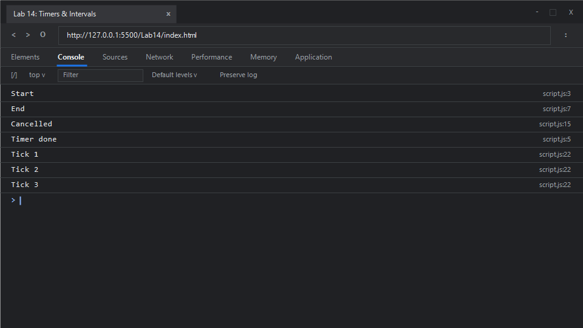

# EXPERIMENT NO. 14

## 1. Experiment Title
Timers and Intervals

## 2. Aim
Run code after a delay with `setTimeout`, cancel a timer, and repeat code with `setInterval`.

## 3. Software / Tools Required
- **Operating System**: Windows 10 / 11
- **Web Browser**: Google Chrome / Microsoft Edge (Developer Tools F12)
- **Runtime Environment**: Node.js (v18+)
- **Code Editor / IDE**: Visual Studio Code

## 4. Theory
- **JavaScript Concurrency and the Event Loop**:
  - JavaScript is single-threaded and employs an event-driven, non-blocking concurrency model. Synchronous code on the Call Stack executes to completion before any callbacks waiting in the Task (Callback) Queue or Microtask Queue are dequeued.
- **`setTimeout(callback, delay)`**:
  - Schedules a function to run after a specified interval of time (in milliseconds). Even with a delay of `0ms`, the callback is placed into the Macrotask Queue and executed only after all synchronous code on the call stack finishes.
- **`clearTimeout(timerId)`**:
  - Cancels a timeout previously established by calling `setTimeout()`, preventing its callback from executing if it hasn't fired yet.
- **`setInterval(callback, delay)` and `clearInterval(intervalId)`**:
  - `setInterval()` repeatedly calls a function or executes a code snippet with a fixed time delay between each call. It returns a numeric interval ID used by `clearInterval()` to halt repeating execution.

## 5. Algorithm / Procedure
1. **Task 1 (Event Loop Execution Order)**:
   - Output `"Start"`.
   - Call `setTimeout(() => console.log("Timer done"), 0)`.
   - Output `"End"`.
   - Observe that synchronous statements (`"Start"` and `"End"`) finish before the zero-delay asynchronous callback executes (`"Timer done"`).
2. **Task 2 (Timer Cancellation)**:
   - Schedule a 1000ms timer with `timerId = setTimeout(...)`.
   - Cancel the timer immediately via `clearTimeout(timerId)`.
   - Print `"Cancelled"`.
3. **Task 3 (Repeating Interval Execution and Termination)**:
   - Initialize counter variable `tickCount = 0`.
   - Set up an interval with `intervalId = setInterval(...)` running every 200ms.
   - Inside the callback, increment `tickCount` and print `"Tick " + tickCount`.
   - Check if `tickCount === 3`; if so, invoke `clearInterval(intervalId)` to stop further repetitions.
4. Run in Node.js and inspect the browser console.

## 6. Program / Queries / Commands

### File: `script.js`
```javascript
/**
 * Experiment 14: Timers and Intervals
 * Tasks:
 * 1. Print "Start", schedule "Timer done" with setTimeout(..., 0), print "End". Observe execution order
 * 2. Schedule "Not shown" with setTimeout(..., 1000), save id, cancel with clearTimeout(id), print "Cancelled"
 * 3. Use setInterval to print "Tick <count>" every 200ms, stop with clearInterval when count reaches 3
 */

// Task 1: Asynchronous execution queue with setTimeout
console.log("Start");
setTimeout(() => {
    console.log("Timer done");
}, 0);
console.log("End");

// Task 2: Cancelling scheduled timer using clearTimeout
const timerId = setTimeout(() => {
    console.log("Not shown");
}, 1000);

clearTimeout(timerId);
console.log("Cancelled");

// Task 3: Repeating interval with setInterval and termination via clearInterval
let tickCount = 0;
const intervalId = setInterval(() => {
    tickCount++;
    console.log("Tick " + tickCount);
    if (tickCount === 3) {
        clearInterval(intervalId);
    }
}, 200);
```

### Execution Commands:
- **Node.js**:
  ```bash
  node script.js
  ```
- **Browser**:
  Open `index.html` in Chrome/Edge and open Developer Tools (<kbd>F12</kbd> &rarr; **Console**).

## 7. Input
- Task 1: Delay `0` ms
- Task 2: Delay `1000` ms, cancelled immediately
- Task 3: Interval cadence `200` ms, stopping at count `3`

## 8. Output

### Expected Console Output:
```text
Start
End
Cancelled
Timer done
Tick 1
Tick 2
Tick 3
```

### Browser Console Screenshot:


## 9. Result
JavaScript event loop asynchronous scheduling mechanics, non-blocking execution order, timer cancellation via `clearTimeout`, and cyclic timer controls using `setInterval` and `clearInterval` were successfully executed and validated.

## 10. Viva-Voce Questions
1. **Why does `setTimeout(..., 0)` not execute immediately?**
   - The delay parameter represents the *minimum* threshold before the callback is moved to the Task Queue. The JavaScript engine must clear all synchronous frames from the Call Stack before processing queued callbacks.
2. **What is the difference between Macrotasks and Microtasks?**
   - Microtasks (e.g., Promise callbacks, `queueMicrotask`) have higher execution priority and run immediately after the current script, before the event loop picks up the next macrotask (e.g., `setTimeout`, `setInterval`).
3. **What is timer throttling in web browsers?**
   - To optimize CPU and battery consumption, modern browsers throttle background or inactive tabs so that timers execute with a minimum interval of 1000ms or more.
4. **Why is recursive `setTimeout` often preferred over `setInterval` for complex async tasks?**
   - Recursive `setTimeout` ensures that the subsequent delay begins only *after* the preceding asynchronous operation has fully finished, avoiding task overlap and drift.

