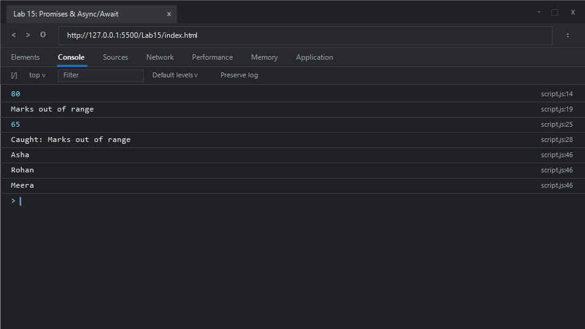

# EXPERIMENT NO. 15

## 1. Experiment Title
Promises and async/await with Local Data

## 2. Aim
Create a Promise that resolves or rejects, use `async`/`await` with `try` and `catch`, and load local data as a Promise.

## 3. Software / Tools Required
- **Operating System**: Windows 10 / 11
- **Web Browser**: Google Chrome / Microsoft Edge (Developer Tools F12)
- **Runtime Environment**: Node.js (v18+)
- **Code Editor / IDE**: Visual Studio Code

## 4. Theory
- **JavaScript Promises**:
  - A `Promise` is an object representing the eventual completion (fulfillment) or failure (rejection) of an asynchronous operation and its resulting value.
  - A Promise is in one of three states:
    1. *Pending*: Initial state, neither fulfilled nor rejected.
    2. *Fulfilled*: The operation completed successfully (`resolve()`).
    3. *Rejected*: The operation failed (`reject()`).
  - Handled via `.then()` for resolution and `.catch()` for errors.
- **`async` / `await` Syntax**:
  - Introduced in ECMAScript 2017 (ES8), `async`/`await` is syntactic sugar built on top of Promises.
  - An `async` function always returns a Promise. The `await` expression pauses the execution of the async function until the Promise settles, enabling asynchronous code to be structured synchronously and readably.
- **Error Interception with `try...catch`**:
  - When using `await`, rejected Promises throw an exception that can be caught seamlessly using standard `try...catch` blocks.
- **Simulating Local Data Retrieval**:
  - Promises combined with timers allow simulating real-world network requests, API queries, or database reads with asynchronous delays.

## 5. Algorithm / Procedure
1. **Task 1 (Promise Resolution)**:
   - Define `checkMarks(marks)` returning `new Promise((resolve, reject) => ...)`:
     - If `marks >= 0 && marks <= 100`, call `resolve(marks)`.
     - Otherwise, call `reject(new Error("Marks out of range"))`.
   - Call `checkMarks(80).then(val => console.log(val))`.
2. **Task 2 (Promise Rejection)**:
   - Call `checkMarks(120).catch(err => console.log(err.message))`.
   - Verify that the error message `"Marks out of range"` is logged.
3. **Task 3 (`async` / `await` and `try...catch`)**:
   - Define `async function run()`.
   - Inside `try`, await and print `checkMarks(65)` (65).
   - Then await `checkMarks(-5)`, which rejects and triggers the `catch` block.
   - Catch block logs `"Caught: " + err.message`.
   - Invoke `run()`.
4. **Task 4 (Asynchronous Local Data Fetching)**:
   - Define `getUsers()` returning a Promise that resolves after a 100ms timeout with local user objects `[{id:1, name:"Asha"}, {id:2, name:"Rohan"}, {id:3, name:"Meera"}]`.
   - Define `async function displayUsers()` that awaits `getUsers()` and iterates over the array to print each `user.name`.
   - Invoke `displayUsers()`.
5. Run in Node.js and inspect the browser console.

## 6. Program / Queries / Commands

### File: `script.js`
```javascript
/**
 * Experiment 15: Promises and async/await with Local Data
 * Tasks:
 * 1. Function checkMarks(marks): resolves with marks (0-100), rejects with Error("Marks out of range"). Call with 80 and print value
 * 2. Call checkMarks(120) and print error message when rejected
 * 3. async function run(): try await checkMarks(65), await checkMarks(-5), catch prints "Caught: " + error.message. Call run()
 * 4. Function getUsers(): returns Promise resolving after 100ms with [{id:1, name:"Asha"}, {id:2, name:"Rohan"}, {id:3, name:"Meera"}].
 *    async function prints each name, then call it
 */

// Core validation Promise factory
function checkMarks(marks) {
    return new Promise((resolve, reject) => {
        if (marks >= 0 && marks <= 100) {
            resolve(marks);
        } else {
            reject(new Error("Marks out of range"));
        }
    });
}

// Task 1: Promise Resolution
checkMarks(80)
    .then(val => {
        console.log(val); // 80
    });

// Task 2: Promise Rejection Handling
checkMarks(120)
    .catch(err => {
        console.log(err.message); // "Marks out of range"
    });

// Task 3: async / await with try...catch
async function run() {
    try {
        const mark1 = await checkMarks(65);
        console.log(mark1); // 65
        const mark2 = await checkMarks(-5);
        console.log(mark2);
    } catch (err) {
        console.log("Caught: " + err.message); // "Caught: Marks out of range"
    }
}
run();

// Task 4: Asynchronous local data retrieval
function getUsers() {
    return new Promise((resolve) => {
        setTimeout(() => {
            resolve([
                { id: 1, name: "Asha" },
                { id: 2, name: "Rohan" },
                { id: 3, name: "Meera" }
            ]);
        }, 100);
    });
}

async function displayUsers() {
    const users = await getUsers();
    users.forEach(user => {
        console.log(user.name);
    });
}
displayUsers();
```

### Execution Commands:
- **Node.js**:
  ```bash
  node script.js
  ```
- **Browser**:
  Open `index.html` in Chrome/Edge and open Developer Tools (<kbd>F12</kbd> &rarr; **Console**).

## 7. Input
- Task 1: Valid marks `80` (within range `0-100`)
- Task 2: Invalid marks `120` (outside range `0-100`)
- Task 3: Sequential calls with `65` (valid) and `-5` (invalid)
- Task 4: Mock local dataset of 3 user records delayed by 100ms

## 8. Output

### Expected Console Output:
```text
80
Marks out of range
65
Caught: Marks out of range
Asha
Rohan
Meera
```

### Browser Console Screenshot:


## 9. Result
Creation and consumption of JavaScript Promises, rejection interception with `.catch()`, synchronous-style asynchronous flow control using `async`/`await`, structured error recovery with `try...catch`, and asynchronous mock data fetching were successfully demonstrated.

## 10. Viva-Voce Questions
1. **What is the difference between a Promise and `async/await`?**
   - `async/await` is syntactic sugar built on top of Promises. While Promises use chaining methods like `.then()` and `.catch()`, `async/await` allows developers to write asynchronous code that looks and behaves like synchronous code, improving readability.
2. **What happens if an `await` statement is executed on a non-Promise value?**
   - The value is automatically converted into a resolved Promise (`Promise.resolve(value)`), and the execution continues.
3. **What is `Promise.all()` and how does it handle rejections?**
   - `Promise.all()` takes an iterable of Promises and resolves when all have resolved. If even a single Promise rejects, `Promise.all()` rejects immediately with the reason of the first rejected Promise ("fail-fast").
4. **How does `Promise.allSettled()` differ from `Promise.all()`?**
   - `Promise.allSettled()` waits for all promises to either resolve or reject, returning an array of objects describing each Promise's final outcome (`status: "fulfilled"` or `status: "rejected"`).

