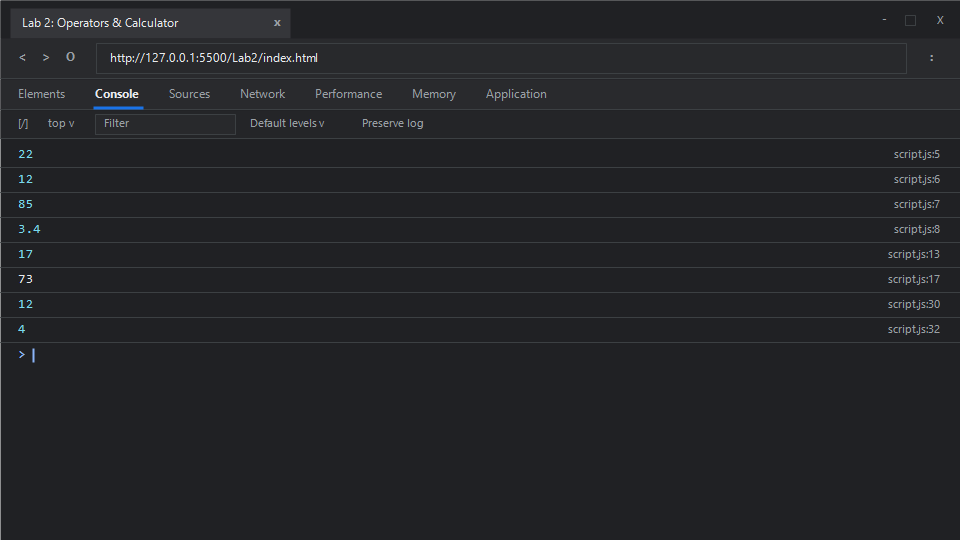

# EXPERIMENT NO. 2

## 1. Experiment Title
Operators, Type Conversion and a Calculator

## 2. Aim
Use arithmetic operators, convert between text and numbers, and use `if` and `else if` to choose an operation.

## 3. Software / Tools Required
- **Operating System**: Windows 10 / 11
- **Web Browser**: Google Chrome / Microsoft Edge (Developer Tools F12)
- **Runtime Environment**: Node.js (v18+)
- **Code Editor / IDE**: Visual Studio Code

## 4. Theory
- **Arithmetic Operators**:
  - Addition (`+`), Subtraction (`-`), Multiplication (`*`), and Division (`/`) perform standard mathematical calculations on numerical operands.
- **Type Conversion (Coercion vs. Explicit Conversion)**:
  - **Explicit Conversion**: Converting a value from one type to another intentionally using built-in constructors like `Number()` or `String()`. For example, `Number("12")` yields `12`, and `String(7)` yields `"7"`.
  - **Implicit Coercion**: When `+` is used between a string and a number, JavaScript converts the number to a string and performs string concatenation (`"7" + "3"` yields `"73"`).
- **Conditional Branching (`if` and `else if`)**:
  - Used to execute alternative blocks of code based on logical conditions evaluating to truthy or falsy. Strict equality (`===`) checks both value and type without coercion.

## 5. Algorithm / Procedure
1. **Task 1**:
   - Store 17 in variable `val1` and 5 in variable `val2`.
   - Compute and print `val1 + val2` (sum), `val1 - val2` (difference), `val1 * val2` (product), and `val1 / val2` (quotient) on individual lines.
2. **Task 2**:
   - Store string `"12"` in variable `strVal`.
   - Convert it to a number using `Number(strVal)`, add 5, and print the resulting number (17).
   - Store number 7 in `numVal`, convert it using `String(numVal)`, concatenate with string `"3"`, and print the result (`"73"`).
3. **Task 3**:
   - Initialize variables `numA = 8`, `numB = 4`, and `op = "+"`.
   - Implement conditional checks: if `op === "+"`, print sum; else if `op === "-"`, print difference.
   - Execute the check for `op = "+"`.
   - Reassign `op = "-"` and execute the check again.
4. Execute via Node.js or inspect via browser console.

## 6. Program / Queries / Commands

### File: `script.js`
```javascript
/**
 * Experiment 2: Operators, Type Conversion and a Calculator
 * Tasks:
 * 1. Arithmetic operators on values 17 and 5 (sum, diff, product, quotient)
 * 2. Type conversions: text "12" to number + 5, number 7 to text + "3"
 * 3. Calculator with numbers 8 and 4 using if / else if with operator '+' then '-'
 */

// Task 1: Arithmetic operators
const val1 = 17;
const val2 = 5;
console.log(val1 + val2); // Sum: 22
console.log(val1 - val2); // Difference: 12
console.log(val1 * val2); // Product: 85
console.log(val1 / val2); // Quotient: 3.4

// Task 2: Type conversion
const strVal = "12";
const convertedNum = Number(strVal);
console.log(convertedNum + 5); // 17

const numVal = 7;
const convertedStr = String(numVal);
console.log(convertedStr + "3"); // "73"

// Task 3: Basic Calculator using conditional statements
let numA = 8;
let numB = 4;
let op = "+";

function runCalculator(a, b, operator) {
    if (operator === "+") {
        console.log(a + b);
    } else if (operator === "-") {
        console.log(a - b);
    }
}

// First run with operator '+'
runCalculator(numA, numB, op);

// Change operator to '-' and repeat check
op = "-";
runCalculator(numA, numB, op);
```

### Execution Commands:
- **Node.js**:
  ```bash
  node script.js
  ```
- **Browser**:
  Open `index.html` in Chrome/Edge and open Developer Tools (<kbd>F12</kbd> &rarr; **Console**).

## 7. Input
- Arithmetic test inputs: `17`, `5`
- Type conversion inputs: `"12"`, `7`, `"3"`
- Calculator inputs: `8`, `4`, operator `"+"` and `"-"`

## 8. Output

### Expected Console Output:
```text
22
12
85
3.4
17
73
12
4
```

### Browser Console Screenshot:


## 9. Result
Arithmetic operators, explicit and implicit type conversions, and conditional decision-making constructs using `if` and `else if` were successfully implemented and validated in the browser console.

## 10. Viva-Voce Questions
1. **What is the difference between `==` and `===` in JavaScript?**
   - `==` performs loose equality with type coercion before comparison, while `===` performs strict equality checking both value and data type without coercion.
2. **What does `NaN` represent, and how can you check for it?**
   - `NaN` stands for "Not-a-Number", representing an unrepresentable or invalid mathematical result. You can check for it using `Number.isNaN(value)`.
3. **What is the output of `"5" - 2` vs. `"5" + 2`?**
   - `"5" - 2` outputs `3` because the subtraction operator triggers numeric coercion. `"5" + 2` outputs `"52"` because the addition operator prioritizes string concatenation.
4. **How does `parseInt()` differ from `Number()`?**
   - `parseInt()` parses a string up to the first non-digit character (e.g., `parseInt("12px")` returns `12`), whereas `Number("12px")` returns `NaN`.

