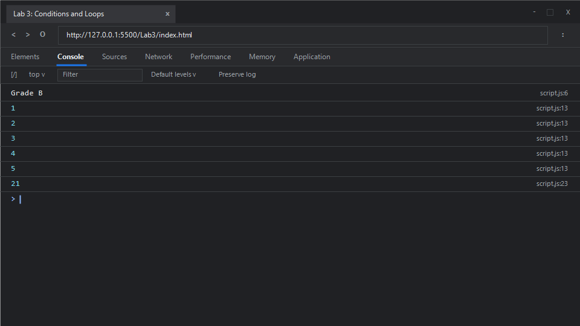

# EXPERIMENT NO. 3

## 1. Experiment Title
Conditions and Loops

## 2. Aim
Choose between cases with `if`, `else if` and `else`, and repeat work with a `for` loop and a `while` loop.

## 3. Software / Tools Required
- **Operating System**: Windows 10 / 11
- **Web Browser**: Google Chrome / Microsoft Edge (Developer Tools F12)
- **Runtime Environment**: Node.js (v18+)
- **Code Editor / IDE**: Visual Studio Code

## 4. Theory
- **Conditional Branching (`if...else if...else`)**:
  - Directs program execution down mutually exclusive branches depending on whether a given boolean expression evaluates to true.
- **The `for` Loop**:
  - An entry-controlled loop comprising initialization, condition check, and increment/decrement. Ideal when the total number of iterations is predetermined.
  - Syntax: `for (initialization; condition; update) { ... }`
- **The `while` Loop**:
  - Repeats a target statement block as long as a specified condition remains true. Suited for indefinite iteration where termination depends on dynamic state changes during runtime.

## 5. Algorithm / Procedure
1. **Task 1 (Grading Decision)**:
   - Initialize variable `marks` with value 72.
   - Check if `marks >= 75`; if true, print `"Grade A"`.
   - Else check if `marks >= 60`; if true, print `"Grade B"`.
   - Otherwise, print `"Grade C"`.
2. **Task 2 (`for` Loop Iteration)**:
   - Initialize counter `i = 1`.
   - As long as `i <= 5`, output `i` and increment `i` by 1.
3. **Task 3 (`while` Loop Accumulation)**:
   - Initialize `total = 0` and `current = 1`.
   - While `total <= 20`, add `current` to `total` and increment `current`.
   - Once the condition breaks (`total > 20`), output `total`.
4. Run the code and verify the console log entries.

## 6. Program / Queries / Commands

### File: `script.js`
```javascript
/**
 * Experiment 3: Conditions and Loops
 * Tasks:
 * 1. Grade categorization based on marks 72 (>=75: Grade A, >=60: Grade B, else: Grade C)
 * 2. for loop printing numbers 1 to 5
 * 3. while loop summing 1, 2, 3... until total > 20, then print total
 */

// Task 1: Conditional grading system
let marks = 72;

if (marks >= 75) {
    console.log("Grade A");
} else if (marks >= 60) {
    console.log("Grade B");
} else {
    console.log("Grade C");
}

// Task 2: for loop printing 1 to 5
for (let i = 1; i <= 5; i++) {
    console.log(i);
}

// Task 3: while loop accumulating sum until total > 20
let total = 0;
let current = 1;

while (total <= 20) {
    total += current;
    current++;
}

console.log(total);
```

### Execution Commands:
- **Node.js**:
  ```bash
  node script.js
  ```
- **Browser**:
  Open `index.html` in Chrome/Edge and open Developer Tools (<kbd>F12</kbd> &rarr; **Console**).

## 7. Input
- Task 1: `marks = 72`
- Task 2: Range `1` to `5`
- Task 3: Sequence `1, 2, 3, 4, 5, 6...` accumulated into `total` until `total > 20`

## 8. Output

### Expected Console Output:
```text
Grade B
1
2
3
4
5
21
```

### Browser Console Screenshot:


## 9. Result
The experiment was performed successfully. Multi-branch conditional structures with `if`, `else if`, and `else` along with iteration control structures using `for` and `while` loops were implemented, tested, and validated.

## 10. Viva-Voce Questions
1. **What is the difference between `while` and `do...while` loops?**
   - A `while` loop checks its condition at the entry point and may never execute if the condition is false initially. A `do...while` loop checks its condition at the exit point, guaranteeing at least one execution of the loop body.
2. **What are the `break` and `continue` statements used for in loops?**
   - `break` terminates the enclosing loop immediately. `continue` skips the remainder of the current iteration and advances execution to the next iteration.
3. **What will happen if the loop condition never becomes false?**
   - It results in an infinite loop, causing high CPU utilization and potentially freezing the browser tab or blocking the Node.js event loop.
4. **Can `switch` statements replace `if...else if` ladders?**
   - Yes, when comparing a single expression against distinct discrete matching values using strict equality (`===`).

