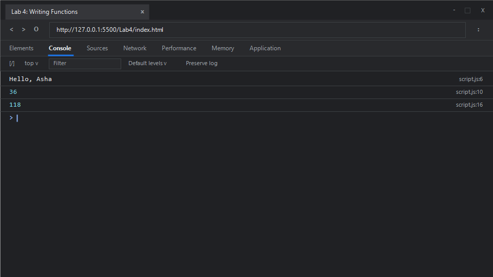

# EXPERIMENT NO. 4

## 1. Experiment Title
Writing Functions

## 2. Aim
Write a function with a return value, an arrow function, and a default parameter.

## 3. Software / Tools Required
- **Operating System**: Windows 10 / 11
- **Web Browser**: Google Chrome / Microsoft Edge (Developer Tools F12)
- **Runtime Environment**: Node.js (v18+)
- **Code Editor / IDE**: Visual Studio Code

## 4. Theory
- **Function Declarations**:
  - Reusable blocks of code defined using the `function` keyword. They are hoisted to the top of their scope and can accept arguments and return values using the `return` statement.
- **Arrow Functions (`=>`)**:
  - Introduced in ECMAScript 2015 (ES6), arrow functions provide a concise syntax for defining anonymous function expressions. They do not have their own `this`, `arguments`, `super`, or `new.target` bindings. Concise single-expression arrow functions benefit from implicit return.
- **Default Parameters**:
  - Allow named parameters to be initialized with default values if no value or `undefined` is passed during the function call (e.g., `function fn(param = defaultValue)`).

## 5. Algorithm / Procedure
1. **Task 1 (Function with Return Value)**:
   - Define a function `greet(name)` that returns `"Hello, " + name`.
   - Call `greet("Asha")` and output the returned result with `console.log()`.
2. **Task 2 (Arrow Function)**:
   - Define an arrow function `square = (num) => num * num`.
   - Call `square(6)` and print the result.
3. **Task 3 (Default Parameter)**:
   - Define `billWithTax(amount, taxRate = 0.18)` returning `amount + (amount * taxRate)`.
   - Invoke `billWithTax(100)` without passing `taxRate`.
   - Print the evaluated total.
4. Run in browser and Node.js to check console outputs.

## 6. Program / Queries / Commands

### File: `script.js`
```javascript
/**
 * Experiment 4: Writing Functions
 * Tasks:
 * 1. Function greet that takes a name and returns "Hello, <name>", print greet("Asha")
 * 2. Arrow function square that returns number * number, print square(6)
 * 3. Function billWithTax(amount, taxRate = 0.18) returning amount + amount * taxRate, print billWithTax(100)
 */

// Task 1: Function declaration with return value
function greet(name) {
    return "Hello, " + name;
}
console.log(greet("Asha"));

// Task 2: ES6 Arrow function
const square = (num) => num * num;
console.log(square(6));

// Task 3: Function with default parameter
function billWithTax(amount, taxRate = 0.18) {
    return amount + (amount * taxRate);
}
console.log(billWithTax(100));
```

### Execution Commands:
- **Node.js**:
  ```bash
  node script.js
  ```
- **Browser**:
  Open `index.html` in Chrome/Edge and open Developer Tools (<kbd>F12</kbd> &rarr; **Console**).

## 7. Input
- Task 1: Name parameter `"Asha"`
- Task 2: Number `6`
- Task 3: Amount `100`, default taxRate `0.18`

## 8. Output

### Expected Console Output:
```text
Hello, Asha
36
118
```

### Browser Console Screenshot:


## 9. Result
Functions with return values, ES6 arrow functions with implicit return syntax, and default parameters were successfully authored, executed, and validated.

## 10. Viva-Voce Questions
1. **How do arrow functions handle the `this` keyword differently from regular functions?**
   - Regular functions bind `this` based on how they are called (runtime context). Arrow functions capture `this` lexically from their enclosing execution context.
2. **Can arrow functions be used as constructors?**
   - No. Arrow functions do not have a `[[Construct]]` internal method or a `prototype` property, so using `new` with an arrow function throws a `TypeError`.
3. **What happens if a function does not have a `return` statement?**
   - The function executes its statements and implicitly returns `undefined`.
4. **When are default parameter values evaluated in JavaScript?**
   - Default parameters are evaluated at call time (lazily), not at definition time.

