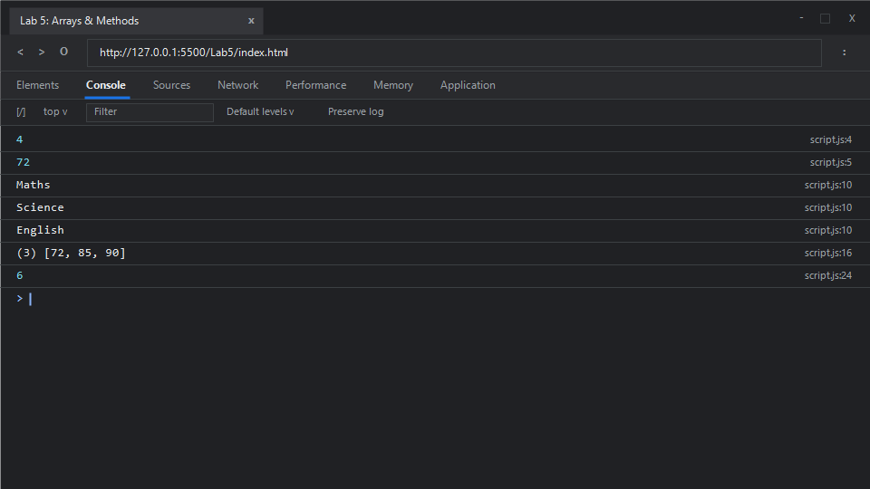

# EXPERIMENT NO. 5

## 1. Experiment Title
Arrays, Array Methods and Nested Arrays

## 2. Aim
Create an array, read its items, use `forEach` and `filter`, and read a value from an array inside an array.

## 3. Software / Tools Required
- **Operating System**: Windows 10 / 11
- **Web Browser**: Google Chrome / Microsoft Edge (Developer Tools F12)
- **Runtime Environment**: Node.js (v18+)
- **Code Editor / IDE**: Visual Studio Code

## 4. Theory
- **JavaScript Arrays**:
  - High-level, list-like objects whose prototype provides methods for traversal and mutation operations. Arrays use zero-based numerical indexing.
- **The `length` Property**:
  - Represents the number of elements in an array.
- **Array Iteration (`forEach`)**:
  - Executes a provided callback function once for each array element in ascending order.
- **Array Filtering (`filter`)**:
  - Creates a shallow copy of a portion of a given array, filtered down to just the elements that pass the test implemented by the provided callback function (returning truthy). It does not mutate the original array.
- **Multidimensional (Nested) Arrays**:
  - An array containing other arrays as its elements. Sub-elements are accessed via sequential bracket notation: `matrix[rowIndex][colIndex]`.

## 5. Algorithm / Procedure
1. **Task 1 (Array Creation and Access)**:
   - Create array `marks = [72, 85, 64, 90]`.
   - Access `marks.length` to get total items (4) and print it.
   - Access `marks[0]` to retrieve the first item (72) and print it.
2. **Task 2 (`forEach` Traversal)**:
   - Create array `subjects = ["Maths", "Science", "English"]`.
   - Invoke `.forEach()` passing an arrow function that prints each subject.
3. **Task 3 (`filter` Method)**:
   - Create array `scores = [72, 85, 45, 90]`.
   - Apply `.filter(score => score >= 60)` to produce a new array containing scores &ge; 60.
   - Output the filtered array.
4. **Task 4 (Nested Array Grid Access)**:
   - Create `grid = [[1, 2, 3], [4, 5, 6]]`.
   - In 1-based human terms, row 2 column 3 corresponds to index `[1][2]` (zero-based).
   - Print `grid[1][2]`.
5. Execute script in terminal and browser.

## 6. Program / Queries / Commands

### File: `script.js`
```javascript
/**
 * Experiment 5: Arrays, Array Methods and Nested Arrays
 * Tasks:
 * 1. Array marks = [72, 85, 64, 90], print number of items and first mark
 * 2. Array subjects = ["Maths", "Science", "English"], use forEach to print each
 * 3. Array marks = [72, 85, 45, 90], use filter to make new array >= 60 and print
 * 4. Nested array grid = [[1, 2, 3], [4, 5, 6]], print row 2, col 3 element
 */

// Task 1: Array length and element indexing
const marks = [72, 85, 64, 90];
console.log(marks.length); // 4
console.log(marks[0]);      // 72

// Task 2: Iteration with forEach
const subjects = ["Maths", "Science", "English"];
subjects.forEach(subject => {
    console.log(subject);
});

// Task 3: Filtering elements with filter()
const scores = [72, 85, 45, 90];
const passingScores = scores.filter(score => score >= 60);
console.log(passingScores);

// Task 4: Nested 2D array (Grid)
const grid = [
    [1, 2, 3],
    [4, 5, 6]
];
// Row 2, Column 3 corresponds to index [1][2]
console.log(grid[1][2]); // 6
```

### Execution Commands:
- **Node.js**:
  ```bash
  node script.js
  ```
- **Browser**:
  Open `index.html` in Chrome/Edge and open Developer Tools (<kbd>F12</kbd> &rarr; **Console**).

## 7. Input
- Task 1: `marks = [72, 85, 64, 90]`
- Task 2: `subjects = ["Maths", "Science", "English"]`
- Task 3: `scores = [72, 85, 45, 90]` with filter threshold `>= 60`
- Task 4: 2D array `grid = [[1, 2, 3], [4, 5, 6]]` with coordinate `[1][2]`

## 8. Output

### Expected Console Output:
```text
4
72
Maths
Science
English
[ 72, 85, 90 ]
6
```

### Browser Console Screenshot:


## 9. Result
Array instantiation, property access, iterative traversal with `forEach`, conditional selection with `filter`, and coordinate access in multidimensional arrays were successfully demonstrated.

## 10. Viva-Voce Questions
1. **Does the `filter()` method modify the original array?**
   - No, `filter()` is a non-mutating method that returns a brand-new array containing only the elements that satisfy the predicate callback function.
2. **What is the difference between `forEach()` and `map()`?**
   - `forEach()` executes a callback for each element without returning a value (`undefined`). `map()` transforms each element and returns a new array of the results.
3. **How do you add and remove elements from the start and end of a JavaScript array?**
   - `push()` appends to the end; `pop()` removes from the end. `unshift()` prepends to the beginning; `shift()` removes from the beginning.
4. **How are sparse arrays handled in JavaScript?**
   - Arrays with empty slots (holes) skip empty indices when processed by methods like `forEach()` and `filter()`.

