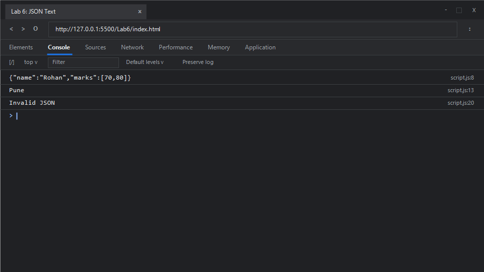

# EXPERIMENT NO. 6

## 1. Experiment Title
JSON Text

## 2. Aim
Convert an object to JSON text, convert JSON text back to an object, and catch invalid JSON.

## 3. Software / Tools Required
- **Operating System**: Windows 10 / 11
- **Web Browser**: Google Chrome / Microsoft Edge (Developer Tools F12)
- **Runtime Environment**: Node.js (v18+)
- **Code Editor / IDE**: Visual Studio Code

## 4. Theory
- **JSON (JavaScript Object Notation)**:
  - A lightweight, text-based, language-independent data interchange format. JSON syntax is a subset of JavaScript object literal syntax, requiring keys and string values to be enclosed in double quotes (`"`).
- **`JSON.stringify()` (Serialization)**:
  - Converts a JavaScript value or object into a JSON string format suitable for transmission over networks or local storage.
- **`JSON.parse()` (Deserialization)**:
  - Parses a JSON string, constructing the JavaScript value or object described by the string. If the string contains invalid JSON syntax, it throws a `SyntaxError`.
- **Exception Handling (`try...catch`)**:
  - The `try` statement encloses a block of statements that may potentially throw an exception. The `catch` statement encloses a block that executes if any exception occurs inside the corresponding `try` block, preventing unhandled exceptions from terminating program execution.

## 5. Algorithm / Procedure
1. **Task 1 (Serialization)**:
   - Create an object `student = { name: "Rohan", marks: [70, 80] }`.
   - Call `JSON.stringify(student)` and store the resulting text.
   - Print the JSON string to the console.
2. **Task 2 (Deserialization)**:
   - Store string `'{"city":"Pune","pin":411001}'` in variable `jsonText`.
   - Parse it into a native JavaScript object using `JSON.parse(jsonText)`.
   - Read and print the `city` property (`"Pune"`).
3. **Task 3 (Error Handling)**:
   - Store malformed string `"{name: Rohan}"` (keys and values unquoted).
   - Place the call `JSON.parse(invalidJsonText)` inside a `try` block.
   - Catch the thrown `SyntaxError` inside a `catch` block and print `"Invalid JSON"`.
4. Run in Node.js and inspect the browser console.

## 6. Program / Queries / Commands

### File: `script.js`
```javascript
/**
 * Experiment 6: JSON Text
 * Tasks:
 * 1. Object { name: "Rohan", marks: [70, 80] }, convert to JSON with JSON.stringify and print
 * 2. Store '{"city":"Pune","pin":411001}', parse with JSON.parse and print city
 * 3. Store '{name: Rohan}', parse inside try/catch, print "Invalid JSON" in catch block
 */

// Task 1: Object to JSON serialization
const student = {
    name: "Rohan",
    marks: [70, 80]
};
const jsonString = JSON.stringify(student);
console.log(jsonString);

// Task 2: JSON deserialization to JavaScript object
const jsonText = '{"city":"Pune","pin":411001}';
const parsedObject = JSON.parse(jsonText);
console.log(parsedObject.city);

// Task 3: Exception handling for malformed JSON
const invalidJsonText = "{name: Rohan}";
try {
    JSON.parse(invalidJsonText);
} catch (error) {
    console.log("Invalid JSON");
}
```

### Execution Commands:
- **Node.js**:
  ```bash
  node script.js
  ```
- **Browser**:
  Open `index.html` in Chrome/Edge and open Developer Tools (<kbd>F12</kbd> &rarr; **Console**).

## 7. Input
- Task 1: JavaScript object `{ name: "Rohan", marks: [70, 80] }`
- Task 2: Valid JSON string `'{"city":"Pune","pin":411001}'`
- Task 3: Invalid JSON string `"{name: Rohan}"`

## 8. Output

### Expected Console Output:
```text
{"name":"Rohan","marks":[70,80]}
Pune
Invalid JSON
```

### Browser Console Screenshot:


## 9. Result
Serialization of JavaScript objects into JSON format, deserialization of valid JSON strings into native objects, and graceful error handling for malformed JSON using `try...catch` were successfully verified.

## 10. Viva-Voce Questions
1. **Why does JSON require double quotes around property names instead of single quotes?**
   - The JSON specification (RFC 8259) strictly mandates double quotes (`"`) to ensure universal portability across various programming languages. Single quotes result in a `SyntaxError`.
2. **What data types are supported in JSON?**
   - Strings, numbers, booleans, arrays, objects, and `null`. Functions, `undefined`, and `Symbol` are not supported.
3. **What happens if you pass an object with a function or `undefined` property to `JSON.stringify()`?**
   - Properties whose values are functions, `undefined`, or symbols are omitted when stringifying an object, or converted to `null` if within an array.
4. **Can JSON handle circular references natively?**
   - No. Stringifying an object with circular references throws a `TypeError: Converting circular structure to JSON`.

