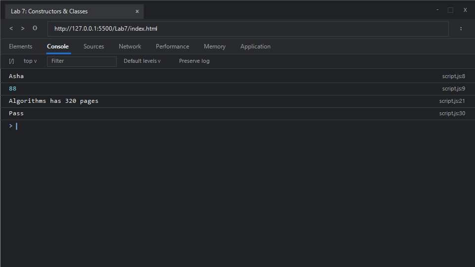

# EXPERIMENT NO. 7

## 1. Experiment Title
Constructor Functions and Classes

## 2. Aim
Create objects with a constructor function and with an ES6 class, and add a method through the prototype.

## 3. Software / Tools Required
- **Operating System**: Windows 10 / 11
- **Web Browser**: Google Chrome / Microsoft Edge (Developer Tools F12)
- **Runtime Environment**: Node.js (v18+)
- **Code Editor / IDE**: Visual Studio Code

## 4. Theory
- **Constructor Functions**:
  - Regular JavaScript functions invoked using the `new` keyword. By convention, their names begin with an uppercase letter. When called with `new`, an empty object is created, `this` is bound to the new instance, and the instance is implicitly returned.
- **Prototypes and Prototypal Delegation**:
  - Every JavaScript function has a `prototype` object property. Adding methods to `Constructor.prototype` enables all created instances to share a single copy of that method in memory via the prototype chain (`__proto__`).
- **ES6 Classes**:
  - Syntactical sugar over JavaScript's existing prototype-based inheritance model. Classes introduce clear object-oriented syntax including `constructor()` methods and instance methods without altering JavaScript's underlying prototypal nature.

## 5. Algorithm / Procedure
1. **Task 1 (Constructor Function)**:
   - Define constructor `Student(name, marks)` assigning `this.name = name` and `this.marks = marks`.
   - Instantiate `student1 = new Student("Asha", 88)`.
   - Print `student1.name` and `student1.marks` on separate lines.
2. **Task 2 (ES6 Class)**:
   - Define class `Book` with a constructor taking `title` and `pages`.
   - Add method `summary()` returning `${this.title} has ${this.pages} pages`.
   - Instantiate `book1 = new Book("Algorithms", 320)`.
   - Print `book1.summary()`.
3. **Task 3 (Prototype Method Injection)**:
   - Attach method `result` to `Student.prototype`:
     `Student.prototype.result = function() { return this.marks >= 40 ? "Pass" : "Fail"; }`.
   - Instantiate `student2 = new Student("Asha", 88)`.
   - Call and print `student2.result()`.
4. Run in terminal or inspect browser console.

## 6. Program / Queries / Commands

### File: `script.js`
```javascript
/**
 * Experiment 7: Constructor Functions and Classes
 * Tasks:
 * 1. Constructor function Student(name, marks), instantiate Asha (88), print name and marks
 * 2. ES6 class Book(title, pages) with summary() method returning "<title> has <pages> pages"
 * 3. Add method result() to Student.prototype (>=40 ? "Pass" : "Fail"), print Asha's result
 */

// Task 1: Constructor Function
function Student(name, marks) {
    this.name = name;
    this.marks = marks;
}

const student1 = new Student("Asha", 88);
console.log(student1.name);
console.log(student1.marks);

// Task 2: ES6 Class Book
class Book {
    constructor(title, pages) {
        this.title = title;
        this.pages = pages;
    }

    summary() {
        return `${this.title} has ${this.pages} pages`;
    }
}

const book1 = new Book("Algorithms", 320);
console.log(book1.summary());

// Task 3: Prototype Method Extension
Student.prototype.result = function() {
    return this.marks >= 40 ? "Pass" : "Fail";
};

const student2 = new Student("Asha", 88);
console.log(student2.result());
```

### Execution Commands:
- **Node.js**:
  ```bash
  node script.js
  ```
- **Browser**:
  Open `index.html` in Chrome/Edge and open Developer Tools (<kbd>F12</kbd> &rarr; **Console**).

## 7. Input
- Task 1: Name `"Asha"`, Marks `88`
- Task 2: Title `"Algorithms"`, Pages `320`
- Task 3: Instance with marks `88` checked against threshold `>= 40`

## 8. Output

### Expected Console Output:
```text
Asha
88
Algorithms has 320 pages
Pass
```

### Browser Console Screenshot:


## 9. Result
Constructor functions, prototype method delegation, and ES6 class syntax were successfully implemented and their runtime behaviors verified.

## 10. Viva-Voce Questions
1. **What happens under the hood when the `new` operator is used with a function?**
   - A new empty plain JavaScript object is created; the object's `[[Prototype]]` is set to the constructor's `prototype`; the constructor function is executed with `this` bound to the newly created object; if the constructor does not return an object, `this` is returned automatically.
2. **Why is it preferable to define methods on `Constructor.prototype` rather than inside the constructor?**
   - Defining methods on the prototype shares a single function instance across all instances, saving memory. Defining inside the constructor creates a new copy of the method every time an instance is constructed.
3. **Are ES6 classes hoisted like function declarations?**
   - No, ES6 class declarations are not hoisted like function declarations; they remain in the Temporal Dead Zone (TDZ) until their declaration is evaluated.
4. **How do you check if an object is an instance of a particular class or constructor?**
   - Using the `instanceof` operator (e.g., `student1 instanceof Student`).

