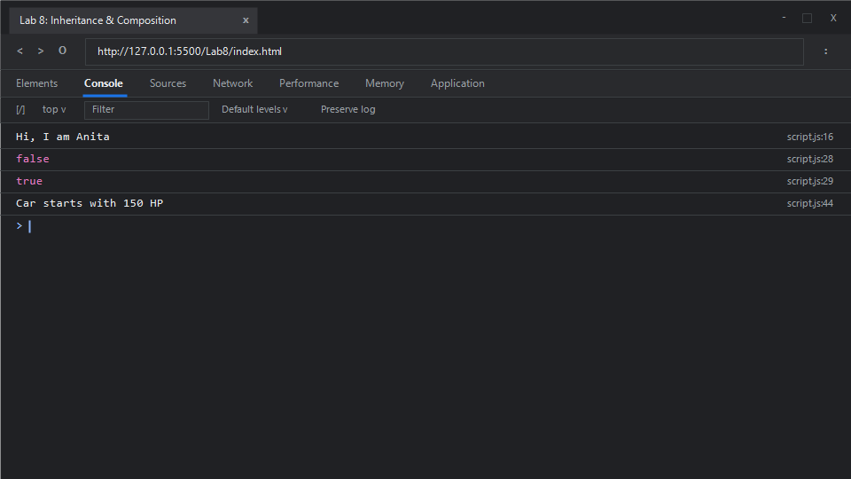

# EXPERIMENT NO. 8

## 1. Experiment Title
Inheritance, Methods and Composition

## 2. Aim
Use `extends` to make a child class, write a method that checks a value, and place one object inside another.

## 3. Software / Tools Required
- **Operating System**: Windows 10 / 11
- **Web Browser**: Google Chrome / Microsoft Edge (Developer Tools F12)
- **Runtime Environment**: Node.js (v18+)
- **Code Editor / IDE**: Visual Studio Code

## 4. Theory
- **Class Inheritance (`extends` and `super`)**:
  - The `extends` keyword allows a child class (subclass) to inherit methods and properties from a parent class (superclass).
  - The `super` keyword must be called inside the derived class's constructor before accessing `this`, delegating instantiation of inherited fields to the parent constructor.
- **Instance Methods**:
  - Functions declared inside the class body that operate on instance state through `this`.
- **Object Composition ("Has-A" Relationship)**:
  - An alternative and often preferred design pattern over inheritance ("is-a" relationship) where complex objects are formed by assembling simpler, focused objects. For example, a `Car` *has* an `Engine`, rather than inheriting from `Engine`.

## 5. Algorithm / Procedure
1. **Task 1 (Inheritance)**:
   - Create parent class `Person` with property `name` and method `greet()` returning `"Hi, I am " + this.name`.
   - Create child class `Teacher` that `extends Person`, calls `super(name)` in its constructor, and adds `this.subject = subject`.
   - Instantiate `teacher = new Teacher("Anita", "Maths")`.
   - Print `teacher.greet()`.
2. **Task 2 (Method Checking)**:
   - Create class `Locker` with default property `pin = 1234` and method `checkPin(enteredPin)` returning `enteredPin === this.pin`.
   - Instantiate `locker = new Locker(1234)`.
   - Print `locker.checkPin(1111)` (false) and `locker.checkPin(1234)` (true).
3. **Task 3 (Composition)**:
   - Create class `Engine` storing `power`.
   - Create class `Car` whose constructor instantiates `this.engine = new Engine(power)`.
   - Add method `start()` to `Car` returning `Car starts with ${this.engine.power} HP`.
   - Instantiate `car = new Car(150)` and print `car.start()`.
4. Run in browser console or Node.js.

## 6. Program / Queries / Commands

### File: `script.js`
```javascript
/**
 * Experiment 8: Inheritance, Methods and Composition
 * Tasks:
 * 1. Class Person with greet() returning "Hi, I am <name>", class Teacher extends Person with subject. Create Anita (Maths) and print greeting
 * 2. Class Locker (pin 1234) with checkPin(num) returning boolean. Print checkPin(1111) and checkPin(1234)
 * 3. Composition: Engine(power) and Car(holds Engine). Car.start() returns "Car starts with <power> HP". Create Car(150), print start()
 */

// Task 1: Class Inheritance using extends and super
class Person {
    constructor(name) {
        this.name = name;
    }

    greet() {
        return "Hi, I am " + this.name;
    }
}

class Teacher extends Person {
    constructor(name, subject) {
        super(name);
        this.subject = subject;
    }
}

const teacher = new Teacher("Anita", "Maths");
console.log(teacher.greet());

// Task 2: Class Locker with conditional validation method
class Locker {
    constructor(pin = 1234) {
        this.pin = pin;
    }

    checkPin(enteredPin) {
        return enteredPin === this.pin;
    }
}

const locker = new Locker(1234);
console.log(locker.checkPin(1111));
console.log(locker.checkPin(1234));

// Task 3: Object Composition (Car composed of an Engine)
class Engine {
    constructor(power) {
        this.power = power;
    }
}

class Car {
    constructor(power) {
        this.engine = new Engine(power);
    }

    start() {
        return `Car starts with ${this.engine.power} HP`;
    }
}

const car = new Car(150);
console.log(car.start());
```

### Execution Commands:
- **Node.js**:
  ```bash
  node script.js
  ```
- **Browser**:
  Open `index.html` in Chrome/Edge and open Developer Tools (<kbd>F12</kbd> &rarr; **Console**).

## 7. Input
- Task 1: Name `"Anita"`, Subject `"Maths"`
- Task 2: Master PIN `1234`, Test PINs `1111` and `1234`
- Task 3: Engine Power `150` HP

## 8. Output

### Expected Console Output:
```text
Hi, I am Anita
false
true
Car starts with 150 HP
```

### Browser Console Screenshot:


## 9. Result
ES6 class inheritance via `extends` and `super()`, method validation logic, and modular object composition patterns were successfully executed and validated.

## 10. Viva-Voce Questions
1. **What is the difference between inheritance and composition?**
   - Inheritance models an "is-a" relationship where a child class acquires attributes and behavior from a parent class. Composition models a "has-a" relationship where an object contains references to other objects to delegate specific responsibilities, promoting loose coupling.
2. **Why must `super()` be called before using `this` in a derived class constructor?**
   - In ES6 derived classes, `this` is not initialized until the parent constructor is executed via `super()`. Accessing `this` beforehand throws a `ReferenceError`.
3. **Can JavaScript classes achieve multiple inheritance directly?**
   - No, JavaScript supports single inheritance only via class `extends`. Multiple inheritance patterns are achieved through mixins or composition.
4. **How can you override a method inherited from a parent class?**
   - By defining a method in the child class with the exact same name as the parent method. You can call the parent version if needed using `super.methodName()`.

