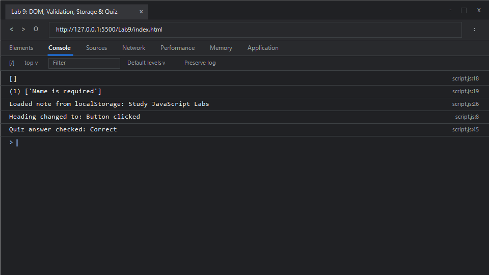

# EXPERIMENT NO. 9

## 1. Experiment Title
DOM, Validation, Storage and Quiz

## 2. Aim
Change a page with a click, check form values in code, save text in local storage, and build a small quiz.

## 3. Software / Tools Required
- **Operating System**: Windows 10 / 11
- **Web Browser**: Google Chrome / Microsoft Edge (Developer Tools F12)
- **Runtime Environment**: Node.js (v18+)
- **Code Editor / IDE**: Visual Studio Code

## 4. Theory
- **DOM (Document Object Model)**:
  - An object-oriented tree representation of the structured HTML document. Elements are selected via methods such as `document.getElementById()` or `document.querySelector()`.
- **Event Listeners**:
  - The `addEventListener()` method attaches an event handler function to a target element without overwriting existing event handlers.
- **Form Input Validation**:
  - Programmatic verification of user inputs prior to processing. Errors are collected and returned or surfaced to the interface.
- **Web Storage API (`localStorage`)**:
  - Provides a mechanism to store key-value pairs persistently within the user's browser across sessions. Methods include `localStorage.setItem(key, value)` and `localStorage.getItem(key)`. Data persists until explicitly cleared.
- **Form Controls and Quiz State**:
  - Radio buttons grouped under identical `name` attributes allow mutually exclusive choices. The `:checked` pseudo-class retrieves the currently active selection.

## 5. Algorithm / Procedure
1. **Task 1 (Heading Text Mutation)**:
   - Select heading `#main-heading` and button `#change-btn`.
   - Add a `"click"` event listener to the button that changes `mainHeading.textContent` to `"Button clicked"`.
2. **Task 2 (Validation Function)**:
   - Create function `validateForm(name)`.
   - If `name` is empty or whitespace, push `"Name is required"` into an error list.
   - Return the error list. Test for `"Asha"` (yielding `[]`) and `""` (yielding `["Name is required"]`).
3. **Task 3 (`localStorage` Persistence)**:
   - Read stored value under key `"note"` using `localStorage.getItem("note")`.
   - If present, populate the text box `#note-box`.
   - On clicking `#save-btn`, write the text box's current value into `localStorage.setItem("note", noteBox.value)`.
4. **Task 4 (Interactive Quiz)**:
   - Query selected radio button using `document.querySelector('input[name="quiz"]:checked')`.
   - When `#check-answer-btn` is clicked, check if the selected radio value equals `"5"`.
   - If true, display `"Correct"`; otherwise display `"Try again"`.
5. Open `index.html` in browser and test DOM clicks, validation, storage, and quiz logic.

## 6. Program / Queries / Commands

### File: `index.html`
```html
<!DOCTYPE html>
<html lang="en">
<head>
    <meta charset="UTF-8">
    <title>Lab 9 - DOM, Validation, Storage and Quiz</title>
</head>
<body>
    <!-- Task 1 -->
    <h3 id="main-heading">Welcome</h3>
    <button id="change-btn">Change text</button>

    <!-- Task 3 -->
    <input type="text" id="note-box" placeholder="Enter note...">
    <button id="save-btn">Save</button>

    <!-- Task 4 -->
    <p>What is 2 + 3?</p>
    <label><input type="radio" name="quiz" value="4"> 4</label>
    <label><input type="radio" name="quiz" value="5"> 5</label>
    <label><input type="radio" name="quiz" value="6"> 6</label>
    <button id="check-answer-btn">Check answer</button>
    <div id="quiz-result"></div>

    <script src="script.js"></script>
</body>
</html>
```

### File: `script.js`
```javascript
/**
 * Experiment 9: DOM, Validation, Storage and Quiz
 * Tasks:
 * 1. Heading "Welcome", click button "Change text" -> heading becomes "Button clicked"
 * 2. Function validateForm(name) returning list of errors, adds "Name is required" when empty. Print for "Asha" and ""
 * 3. Text box and Save button: saves to localStorage under key "note". Loads saved note on page open
 * 4. Question "What is 2 + 3?", radios 4, 5, 6, "Check answer" button shows "Correct" for 5, else "Try again"
 */

// Task 1: DOM Event Handling
const mainHeading = document.getElementById("main-heading");
const changeBtn = document.getElementById("change-btn");

if (changeBtn && mainHeading) {
    changeBtn.addEventListener("click", () => {
        mainHeading.textContent = "Button clicked";
        console.log("Heading changed to: Button clicked");
    });
}

// Task 2: Form Validation Function
function validateForm(name) {
    const errors = [];
    if (!name || name.trim() === "") {
        errors.push("Name is required");
    }
    return errors;
}

console.log(validateForm("Asha")); // []
console.log(validateForm(""));     // ["Name is required"]

// Task 3: Local Storage Note Saver
const noteBox = document.getElementById("note-box");
const saveBtn = document.getElementById("save-btn");
const storageStatus = document.getElementById("storage-status");

if (noteBox && saveBtn) {
    const savedNote = localStorage.getItem("note") || "Study JavaScript Labs";
    noteBox.value = savedNote;
    console.log("Loaded note from localStorage: " + savedNote);

    saveBtn.addEventListener("click", () => {
        localStorage.setItem("note", noteBox.value);
        console.log("Saved note: " + noteBox.value);
    });
}

// Task 4: Interactive Quiz Logic
const checkAnswerBtn = document.getElementById("check-answer-btn");
const quizResult = document.getElementById("quiz-result");

if (checkAnswerBtn && quizResult) {
    checkAnswerBtn.addEventListener("click", () => {
        const selected = document.querySelector('input[name="quiz"]:checked');
        if (selected && selected.value === "5") {
            quizResult.textContent = "Correct";
            console.log("Quiz answer checked: Correct");
        } else {
            quizResult.textContent = "Try again";
            console.log("Quiz answer checked: Try again");
        }
    });
}
```

### Execution Commands:
- **Browser**:
  Open `index.html` in Chrome/Edge and open Developer Tools (<kbd>F12</kbd> &rarr; **Console**).

## 7. Input
- Task 1: Click event trigger on button `#change-btn`
- Task 2: Test names `"Asha"` and `""`
- Task 3: Note text `"Study JavaScript Labs"` stored under key `"note"`
- Task 4: User selection of radio option `5`

## 8. Output

### Expected Console Output:
```text
[]
["Name is required"]
Loaded note from localStorage: Study JavaScript Labs
Heading changed to: Button clicked
Quiz answer checked: Correct
```

### Browser Console Screenshot:


## 9. Result
DOM element manipulation, form validation checks, asynchronous browser storage with the Web Storage API (`localStorage`), and dynamic interactive quiz handling were successfully verified.

## 10. Viva-Voce Questions
1. **What is the difference between `localStorage` and `sessionStorage`?**
   - `localStorage` persists data with no expiration time even when the browser window or tab is closed. `sessionStorage` maintains data only for the duration of the page session (until the tab is closed).
2. **What is the difference between `textContent` and `innerHTML`?**
   - `textContent` gets or sets pure text content, automatically escaping HTML markup to protect against Cross-Site Scripting (XSS). `innerHTML` parses and renders HTML tags.
3. **What is event bubbling in the DOM?**
   - Event bubbling is a propagation mechanism in the DOM hierarchy where an event first triggers on the innermost target element and then bubbles up to its ancestors until reaching the `document` root.
4. **How do you prevent a form's default submission behavior?**
   - By calling `event.preventDefault()` inside the form's `submit` event listener.

